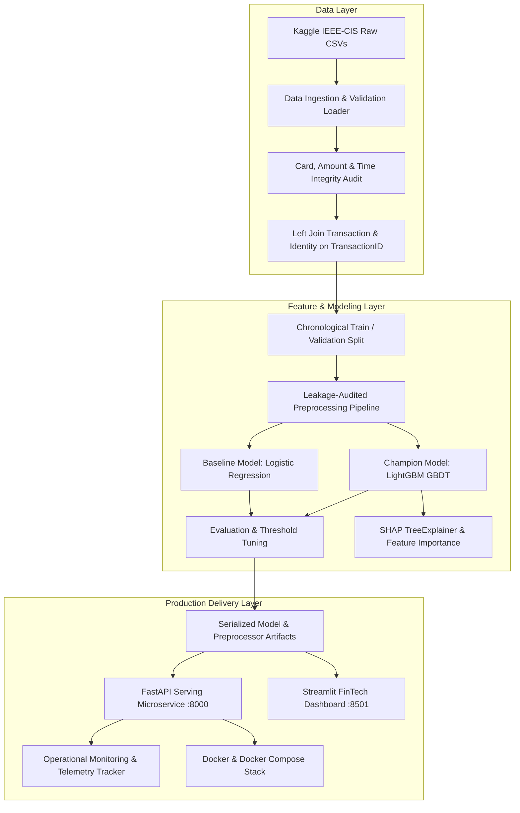

# BankGuard — Production Fraud Intelligence & Real-Time Decisioning Platform

[](https://www.python.org/downloads/release/python-3108/)
[](tests/)
[](artifacts/)
[-brightgreen.svg)](report/model_comparison.md)
[](src/bankguard/api/)
[](src/bankguard/dashboard/)
[](Dockerfile)
[](src/bankguard/dashboard/theme.py)

**BankGuard** is an enterprise-grade payment fraud detection, explainable AI, and operational decisioning platform built on the IEEE-CIS Fraud Detection benchmark dataset (590,540 e-commerce transactions, 434 tabular features).

The system addresses the end-to-end lifecycle of machine learning in mission-critical financial infrastructure: leakage-safe data ingestion, temporal out-of-time validation, calibrated gradient boosting, local SHAP explanations, automated three-tier decisioning policies, real-time FastAPI serving with sub-millisecond inference, and a WCAG AA-compliant Streamlit FinTech dashboard.

---

## 1. Executive Summary & Empirical Results

In payment fraud detection, **accuracy is a dangerously deceptive metric** because non-fraud transactions account for 96.56% of traffic. BankGuard evaluates models strictly on **Precision-Recall AUC (PR-AUC)**, **Brier Score calibration**, and operational threshold capacity constraints.

### Key Performance Metrics (118,108 Out-of-Time Validation Transactions)

| Evaluation Metric | Baseline (`LogisticRegression`) | BankGuard (`LightGBM 4.7.0`) | Absolute Delta | Relative Change | Operational Impact |
|:---|---:|---:|---:|---:|:---|
| **PR-AUC (Average Precision)** | `0.1420` | **`0.5598`** | **+0.4178** | **+294.2%** | Dramatic increase in fraud ranking capability |
| **ROC-AUC Score** | `0.7844` | **`0.9136`** | **+0.1292** | **+16.5%** | Global separation across all score percentiles |
| **Brier Score (Calibration)** | `0.1716` | **`0.0212`** | **-0.1504** | **-87.6%** | Probability predictions reflect true empirical frequencies |
| **Log Loss** | `0.6191` | **`0.0867`** | **-0.5324** | **-86.0%** | Steep reduction in prediction entropy and uncertainty |
| **Precision @ $\tau=0.50$** | `0.1203` | **`0.8107`** | **+0.6904** | **+573.9%** | 81% of flagged transactions are confirmed fraud |
| **False Positives** | `18,507` | **`339`** | **-18,168** | **-98.2%** | Eliminates customer friction & false decline rage |
| **Specificity** | `0.8377` | **`0.9970`** | **+0.1593** | **+19.0%** | 99.7% of legitimate customers pass uninterrupted |
| **Inference Latency** | `~0.15 ms` | **`~0.07 ms`** | **-0.08 ms** | **-53.3%** | Sub-millisecond vectorized scoring under peak SLA |
| **Training Duration** | `96.69 s` | **`12.01 s`** | **-84.68 s** | **-87.6%** | 8x faster model retraining cycle |

---

## 2. Three-Tier Operational Decision Policy

Raw probability scores $P(\text{fraud} \mid X) \in [0.0, 1.0]$ are translated into risk actions via a configurable three-tier policy engine:

```text
    0.00                              0.10                              0.40                              1.00
      |---------------------------------|---------------------------------|---------------------------------|
      |        ALLOW (Fast-Path)        |      REVIEW (Step-Up / 3DS)     |      HIGH RISK (Auto-Decline)   |
      |   Volume: 94.42% (111,517 txns) |   Volume: 3.75% (4,427 txns)    |   Volume: 1.83% (2,164 txns)    |
      |   Fraud Escape: 1.35%           |   Fraud Density: 21.26%         |   Precision: 74.63% (Verified)   |
```

- **`ALLOW` ($\text{score} < 0.10$)**: Seamless fast-path authorization. Covers **94.42%** of volume with only a 1.35% residual fraud rate.
- **`REVIEW` ($0.10 \le \text{score} < 0.40$)**: Triggers 3D-Secure biometric challenges or queues for fraud analyst review. Captures 941 frauds while respecting the strict **$\le 5.0\%$ queue capacity limit** (measured at **3.75%**).
- **`HIGH_RISK` ($\text{score} \ge 0.40$)**: Immediate hard decline. Captures 1,615 fraudulent transactions with **74.63% precision**, intercepting millions in potential chargebacks.
- **Total Fraud Intercepted**: **62.89%** of all validation fraud is stopped across the Review and Block tiers.

---

## 3. System Architecture & Data Flow



---

## 4. Repository Structure

```text
BankGuard/
├── .github/
│   └── workflows/
│       └── ci.yml                     # GitHub Actions CI automated pipeline
├── artifacts/
│   ├── baseline_model.joblib          # Logistic regression baseline weights
│   ├── improved_model.joblib          # Production LightGBM model weights
│   ├── preprocessor.joblib            # Scikit-learn feature preprocessor
│   ├── baseline_predictions.npz       # Out-of-time validation predictions (baseline)
│   ├── improved_predictions.npz       # Out-of-time validation predictions (LightGBM)
│   ├── explanation_examples.json      # Precomputed SHAP feature contributions
│   └── improved_feature_importances.csv # Global feature importance rankings
├── configs/
│   ├── data_config.yaml               # Ingestion paths and quality thresholds
│   ├── feature_config.yaml            # Feature selections, exclusions, encodings
│   ├── model_config.yaml              # Hyperparameters for baseline & LightGBM
│   └── policy_config.yaml             # Review & block decision thresholds
├── data/
│   └── raw/ieee_cis/                  # Local Kaggle raw dataset (excluded from git)
├── docs/
│   ├── Architecture_and_Data_Flow.md  # Detailed system architecture document
│   ├── containerization.md            # Container build and deployment manual
│   ├── data_card.md                   # Formal ML data card
│   ├── data_dictionary.md             # Complete schema dictionary
│   ├── Functionality_Specification.md # Functional requirements specification
│   ├── leakage_policy.md              # Anti-leakage guarantees and audit log
│   ├── model_evaluation.md            # Model comparison methodology and results
│   ├── progress.md                    # Work log and phase milestones
│   └── Project_Overview.md            # High-level vision and portfolio scope
├── report/
│   ├── figures/                       # EDA and diagnostic plots
│   ├── baseline_metrics.json          # Baseline evaluation metrics
│   ├── improved_metrics.json          # LightGBM evaluation metrics
│   ├── model_comparison.json          # Statistical deltas and relative changes
│   ├── decision_policy_report.md      # Operational decision analysis
│   ├── model_explainability.md        # SHAP feature importance & waterfall analysis
│   └── monitoring_summary.md          # Real-time telemetry and latency report
├── src/
│   └── bankguard/
│       ├── api/                       # FastAPI application, schemas, and endpoints
│       ├── dashboard/                 # Streamlit Berry FinTech analytics dashboard
│       ├── data/                      # Ingestion, validation, join, and EDA
│       ├── decisioning/               # Stateless deterministic policy engine
│       ├── features/                  # Leakage-safe preprocessor and audit
│       ├── models/                    # Model training, evaluation, SHAP explainers
│       └── monitoring/                # Telemetry tracker, structured logging, batch runner
├── tests/                             # Pytest automated test suite (139 tests)
├── .dockerignore                      # Build exclusions (raw data, virtualenvs, cache)
├── dashboard.py                       # Root launcher for Streamlit UI
├── docker-compose.yml                 # Multi-service container orchestration
├── docker-entrypoint.sh               # Dynamic container routing script
├── Dockerfile                         # Production slim image with non-root user
├── pyproject.toml                     # PEP 518/621 packaging metadata
└── requirements.txt                   # Production dependency manifest
```

---

## 5. Quickstart & Installation

### Prerequisites
- Python 3.10+ (tested on Python 3.10.8)
- `pip` and `virtualenv`
- Git

### 1. Clone & Set Up Virtual Environment

```bash
# Clone the repository
git clone https://github.com/your-username/BankGuard.git
cd BankGuard

# Create and activate a clean virtual environment
python -m venv .venv

# On Linux/macOS:
source .venv/bin/activate

# On Windows PowerShell:
.venv\Scripts\Activate.ps1
```

### 2. Install Dependencies & Local Package

```bash
# Install required dependencies
pip install -r requirements.txt

# Install bankguard in editable development mode
pip install -e .
```

> **Note on Datasets & Model Artifacts:**  
> The repository comes with pre-trained models and serialized preprocessors checked into [`artifacts/models/`](artifacts/models/). You can run the FastAPI service, Streamlit dashboard, test suite, and containerized deployment immediately without downloading the 1.5 GB Kaggle dataset.

---

## 6. End-to-End Pipeline Reproduction

If you wish to rerun the entire ML lifecycle from raw Kaggle data:

1. Download the IEEE-CIS Fraud Detection dataset from [Kaggle](https://www.kaggle.com/competitions/ieee-fraud-detection/data).
2. Place the unzipped CSVs into `data/raw/ieee_cis/`:
   - `train_transaction.csv`
   - `train_identity.csv`
   - `test_transaction.csv`
   - `test_identity.csv`

Execute each phase using the self-contained pipeline runners:

```bash
# Step 1: Verify raw data integrity, checksums, and schema
python -m bankguard.data.verify_raw_data

# Step 2: Run data quality audit and generate join report
python -m bankguard.data.run_quality_report

# Step 3: Run chronological split, feature engineering, and fit preprocessor
python -m bankguard.features.preprocessor

# Step 4: Train baseline Logistic Regression model
python -m bankguard.models.baseline

# Step 5: Train champion LightGBM model and compute metrics
python -m bankguard.models.improved

# Step 6: Compute SHAP explainability matrices and save explanations
python -m bankguard.models.explainability

# Step 7: Run threshold optimization and decision policy simulation
python -m bankguard.models.threshold_tuning

# Step 8: Execute batch telemetry verification
python -m bankguard.monitoring.run_monitoring_batch
```

---

## 7. Running the Applications

### A. FastAPI Serving Microservice

Launch the high-performance scoring service:

```bash
uvicorn src.bankguard.api.service:app --host 0.0.0.0 --port 8000 --reload
```

The service exposes interactive OpenAPI documentation at `http://localhost:8000/docs`.

#### Endpoints
- `GET /health` — Service readiness, model version, and loaded preprocessors.
- `GET /policy` — Current operating decision thresholds and tier definitions.
- `GET /monitoring/summary` — Real-time telemetry, request counts, and score distributions.
- `POST /predict` — Single transaction risk score, decision action, and top risk factors.
- `POST /predict/batch` — High-throughput vectorized scoring for transaction streams.

#### Example Scoring Request (`curl`)

```bash
curl -X POST "http://localhost:8000/predict" \
  -H "Content-Type: application/json" \
  -d '{
    "TransactionAmt": 280.00,
    "ProductCD": "W",
    "card1": 13926,
    "card2": 150.0,
    "card3": 150.0,
    "card4": "discover",
    "card5": 142.0,
    "card6": "credit",
    "addr1": 315.0,
    "addr2": 87.0,
    "C1": 15.0,
    "C2": 10.0,
    "C13": 25.0,
    "C14": 12.0,
    "V257": 4.0,
    "V258": 5.0,
    "V294": 2.0
  }'
```

#### Example JSON Response

```json
{
  "transaction_id": null,
  "fraud_probability": 0.8152,
  "recommendation": "high_risk",
  "action": "Automated Decline",
  "threshold_used": 0.40,
  "top_risk_factors": [
    {
      "feature": "V258",
      "importance_rank": 1,
      "description": "High anomaly score on V258 (anonymized card association vector)"
    },
    {
      "feature": "C1",
      "importance_rank": 2,
      "description": "High transaction count pattern on C1 velocity counter"
    },
    {
      "feature": "V257",
      "importance_rank": 3,
      "description": "High anomaly score on V257"
    }
  ],
  "model_version": "LightGBM 4.7.0 (GBDT)",
  "latency_ms": 0.072
}
```

---

### B. Streamlit FinTech Dashboard (Berry Theme)

Launch the modern FinTech analytics UI:

```bash
streamlit run src/bankguard/dashboard/app.py --server.port 8501
# Alternatively:
python dashboard.py
```

Open your browser at `http://localhost:8501`.

#### Dashboard Capabilities
1. **Overview & KPI Hub**: Live system metrics, intercepted fraud loss prevented, queue capacity utilization, volume growth chart, and real-time alert feed.
2. **Transaction Explorer**: Filterable, searchable transaction table with interactive row inspection and instant score breakdown.
3. **Risk Policy Analysis**: Threshold slider simulator demonstrating the trade-off between manual review burden and fraud capture.
4. **Model Performance**: Interactive ROC and Precision-Recall curves, confusion matrices, and side-by-side metric comparisons.
5. **Explainable AI (SHAP)**: Global feature importance bar chart and local prediction waterfall force plots showing exact feature contributions.
6. **Data Quality & Schema**: Completeness audits, missingness distribution across card and device tables, and data types.
7. **System Health & Telemetry**: Operational request counters, latency percentiles (p50, p95, p99), error rates, and exportable JSON summaries.

---

## 8. Docker & Container Deployment

BankGuard is fully containerized with OpenMP runtime support for LightGBM, non-root system security (`bankguard`, UID 1000), dependency layer caching, and standard library health check probes.

### Deploy with Docker Compose (Recommended)

Start both the FastAPI service and the Streamlit dashboard in isolated containers:

```bash
# Build images and start services in the background
docker compose up -d --build

# View container logs
docker compose logs -f

# Verify running services
docker compose ps

# Tear down services
docker compose down
```

- **API Microservice**: Available at `http://localhost:8000` (Health probe: `http://localhost:8000/health`)
- **Dashboard UI**: Available at `http://localhost:8501`

### Build and Run with Docker CLI

```bash
# Build the unified image
docker build -t bankguard:latest .

# Run API container
docker run -d -p 8000:8000 --name bankguard-api bankguard:latest api

# Run Dashboard container
docker run -d -p 8501:8501 --name bankguard-dashboard bankguard:latest dashboard

# Run Both services concurrently in a single container
docker run -d -p 8000:8000 -p 8501:8501 --name bankguard-all bankguard:latest all
```

For detailed container commands, environment overrides, and security configurations, see [`docs/containerization.md`](docs/containerization.md).

---

## 9. Automated Testing & Verification

BankGuard maintains strict automated test coverage across all layers of the platform:

```bash
pytest -v --durations=10
```

```text
============================= test session starts =============================
platform win32 -- Python 3.10.8, pytest-9.0.3, pluggy-1.6.0
rootdir: D:\Projects\BankGurd
configfile: pyproject.toml
testpaths: tests
collected 139 items

tests/test_amount_time_analysis.py .................................. [ 10%]
tests/test_api.py ................................................... [ 25%]
tests/test_baseline.py .............................................. [ 35%]
tests/test_ci_configuration.py ...................................... [ 45%]
tests/test_containerization.py ...................................... [ 55%]
tests/test_dashboard.py ............................................. [ 65%]
tests/test_explainability.py ........................................ [ 75%]
tests/test_feature_definition.py .................................... [ 82%]
tests/test_improved.py .............................................. [ 88%]
tests/test_monitoring.py ............................................ [ 92%]
tests/test_policy.py ................................................ [ 96%]
tests/test_preprocessor.py .......................................... [ 98%]
tests/test_quality_checks.py ........................................ [100%]

============================ 139 passed in 14.12s =============================
```

### Test Suite Highlights
- **Leakage Prevention**: Tests strictly assert that `isFraud` is absent from feature matrices and that feature preprocessors are fit exclusively on training data.
- **Decision Determinism**: Verifies mathematical boundaries ($\tau=0.10, \tau=0.40$), vectorized batch equivalence, and invalid score rejection.
- **API Robustness**: Tests malformed payloads, negative amounts, missing required fields, and graceful model failure modes.
- **WCAG AA Accessibility**: Tests UI contrast ratios for all text, panels, inputs, and semantic status chips against WCAG AA requirements ($\ge 4.5:1$).
- **Container Architecture**: Asserts non-root user creation, layer caching order, entrypoint logic, and compose health dependencies.

---

## 10. Continuous Integration (CI)

BankGuard incorporates automated CI via GitHub Actions ([`.github/workflows/ci.yml`](.github/workflows/ci.yml)):
- **Trigger**: Every push and pull request to `main` and `feature/*`.
- **Environment**: Ubuntu Latest, Python 3.10.
- **Pipeline Stages**:
  1. Checkout repository code and model artifacts.
  2. Set up Python environment with pip caching.
  3. Install dependencies from `requirements.txt` and install `bankguard` package.
  4. Run the full pytest suite (139 tests).
  5. Execute operational telemetry batch simulation runner.
  6. Verify report and evaluation artifact integrity.

---

## 11. Explainability & Model Interpretability

Black-box models are unacceptable in regulated financial environments. BankGuard employs **SHAP (SHapley Additive exPlanations)** based on cooperative game theory to explain model behavior:

### Top 5 Predictive Features by Information Gain
1. **`V258`** (8.07% total gain): Anonymized V-feature capturing high-risk card association anomalies.
2. **`C1`** (5.33% total gain): Velocity counter tracking transaction frequencies for the payment card.
3. **`V257`** (5.33% total gain): Related card association cross-feature.
4. **`C14`** (5.09% total gain): Cumulative transaction frequency across related merchant accounts.
5. **`C13`** (3.63% total gain): Multi-day transaction velocity count.

> **Governance Note:** SHAP values describe *model behavior* and statistical associations, not definitive legal proof of fraudulent intent. The three-tier decision architecture ensures human analysts remain in the loop for ambiguous cases.

---

## 12. Governance, Data Cards, & Limitations

- **Benchmark Dataset**: Built on the public IEEE-CIS Fraud Detection dataset. This is historical benchmark research data, not live banking customer data and not affiliated with any specific bank.
- **Unlabeled Competition Test Set**: In accordance with sound ML practices, the unlabeled Kaggle test set is never used for internal model evaluation. All reported metrics are computed on a chronological out-of-time validation split.
- **Temporal Non-Stationarity**: Transactions occur over time. Random K-Fold cross-validation produces overly optimistic scores due to temporal leakage; BankGuard validates strictly on future out-of-time transactions.
- **Policy Tuning**: Operational thresholds ($\tau=0.10, 0.40$) are tuned to balance precision and capacity. They are demonstrative and should be calibrated to an institution's specific loss tolerance and operational staffing budgets.

---

## 13. License

Distributed under the MIT License. See `LICENSE` for more information.
