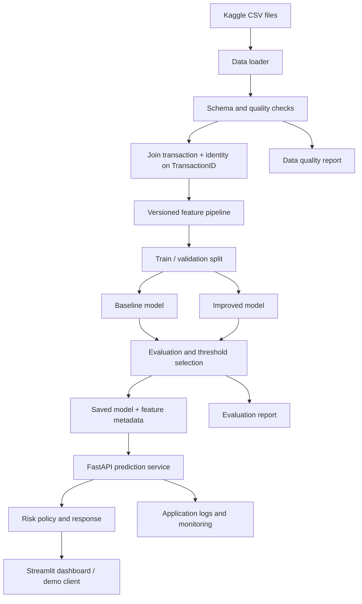

# BankGuard — Architecture and Data Flow

## 1. Purpose

This document explains how data moves through BankGuard, which component owns each task, and how to verify that the flow works.

## 2. Architecture



## 3. Component responsibilities

| Component | What it does | How to implement | Expected output | How to verify |
|---|---|---|---|---|
| Data loader | Reads official competition CSV files | Use pandas; configure paths, dtypes, and target handling | Loaded tables and row/column counts | Run loader; compare counts with source files |
| Quality checks | Finds missing columns, duplicate IDs, invalid target values, and unexpected types | Write explicit checks that fail loudly for critical problems | `data_quality_report.json` or Markdown report | Test each check with a small deliberately invalid fixture |
| Join layer | Adds identity fields to transaction rows | Left-join on `TransactionID`; validate join cardinality | Joined training table | Confirm row count does not unexpectedly increase; check key uniqueness |
| Feature pipeline | Applies repeatable transformations | Use a scikit-learn `Pipeline`/`ColumnTransformer` where possible | Consistent feature matrix | Fit on training data only; transform validation data without refitting |
| Splitter | Keeps validation data separate | Use a fixed seed and stratification initially; document that random split is not a live-time simulation | Stable train and validation indices | Rerun and confirm the split is identical |
| Trainer | Fits candidate models | Train a simple baseline first, then a stronger tabular model | Versioned model artifacts | Re-run training and record parameters and package versions |
| Evaluator | Measures model quality | Compute PR-AUC, ROC-AUC, precision, recall, F1, confusion matrix, and threshold results | `model_evaluation.md` or JSON/CSV artifacts | Recompute metrics from saved predictions |
| Decision policy | Maps score to a recommendation | Use configurable thresholds; do not embed policy in training code | `review`, `allow`, or `high_risk` recommendation as configured | Unit-test values below, at, and above each threshold |
| API | Accepts features and returns score/policy result | FastAPI + Pydantic validation; load the saved pipeline at startup | JSON response with model version | Use API test client and invalid payload tests |
| Dashboard | Makes results easy to inspect | Streamlit pages for dataset, evaluation, and demo scoring | Browser-based demo | Confirm numbers match saved evaluation artifact |
| Monitoring | Tracks inputs, failures, and score distribution | Structured logs and simple summaries; do not log sensitive raw fields unnecessarily | Health and drift summaries | Feed known test batches and verify alerts/checks |

## 4. Data flow in detail

### Step A — Download and locate the data

**Do**
1. Download the IEEE-CIS competition files from Kaggle using an authorized account.
2. Extract them into a local data directory.
3. Keep raw files read-only and outside Git.

**How**
- Suggested location: `data/raw/ieee_cis/`
- Store only the download instructions and file names in the repository, not the data itself.

**Outcome**
- Four main CSVs and the sample submission file are available locally.

**Verify**
- A script lists expected files, file sizes, row counts, and columns.
- Missing files produce a clear error rather than silently continuing.

### Step B — Validate and join

**Do**
- Validate `TransactionID` and `isFraud`.
- Check duplicate transaction IDs.
- Left-join identity records to transaction records using `TransactionID`.

**Why a left join?**
- The transaction table is the primary table. A missing identity row should not silently delete a transaction.

**Outcome**
- One training row per transaction, with identity fields missing where no identity match exists.

**Verify**
- Assert key uniqueness before the join.
- Confirm the joined row count equals the transaction table row count.
- Report the percentage of transactions with a matching identity record.

### Step C — Split and transform

**Do**
- Create train and validation partitions before fitting encoders, imputers, scalers, feature selectors, or resampling methods.
- Fit transformations only on the training partition.
- Keep `isFraud` out of the input features.

**How**
- Start with a reproducible stratified split and a fixed seed.
- Document that a random split can overstate performance for future-time deployment; add a time-based evaluation as a later robustness check if the data structure supports a defensible split.

**Outcome**
- No target column is accidentally used as an input, and validation rows do not fit preprocessing steps.

**Verify**
- Add tests that ensure `isFraud` is not in feature columns.
- Check the saved pipeline is fitted on training data only.

### Step D — Train and evaluate

**Do**
- Establish a simple baseline.
- Train a stronger tabular model.
- Compare both using the same validation rows and metrics.

**Outcome**
- A fair comparison with saved predictions, metrics, parameters, and package versions.

**Verify**
- Recompute metrics from saved predictions.
- Confirm the selected model was chosen using validation results, not the unlabeled Kaggle test set.

### Step E — Serve a score

**Do**
- Load the saved preprocessing pipeline and model together.
- Validate incoming fields.
- Return a score, configured policy result, model version, and available explanation.

**Important**
- The API is a demonstration over the dataset's feature schema. It is not connected to a payment processor and does not authorize or decline real payments.

**Verify**
- A known test record produces a valid response.
- Missing required fields and invalid types return clear client errors.
- Model loading failure prevents the service from claiming to be ready.

## 5. Suggested repository structure

```text
BankGuard/
├── README.md
├── docs/
│   ├── Project_Overview.md
│   ├── Architecture_and_Data_Flow.md
│   ├── Functionality_Specification.md
│   ├── implementation_plan.md
│   ├── progress.md
│   ├── data_card.md
│   ├── data_dictionary.md
│   └── model_evaluation.md
├── data/
│   ├── raw/                 # local only; do not commit
│   ├── processed/           # local/generated; do not commit by default
│   └── reports/
├── notebooks/
├── src/bankguard/
│   ├── data/
│   ├── features/
│   ├── models/
│   ├── decisioning/
│   ├── api/
│   └── monitoring/
├── app/
├── tests/
├── configs/
├── artifacts/               # generated model files; usually not committed
└── requirements.txt
```

## 6. Architecture acceptance checklist

- [ ] Each component has one clear responsibility.
- [ ] Raw data is not changed in place.
- [ ] The identity join cannot multiply transaction rows.
- [ ] Preprocessing is fitted only on training data.
- [ ] Model and preprocessing are saved together.
- [ ] API output includes a score and a policy outcome, not an unsupported guarantee.
- [ ] Evaluation artifacts are separate from application logs.
- [ ] Every generated artifact can be traced to a command and configuration.
