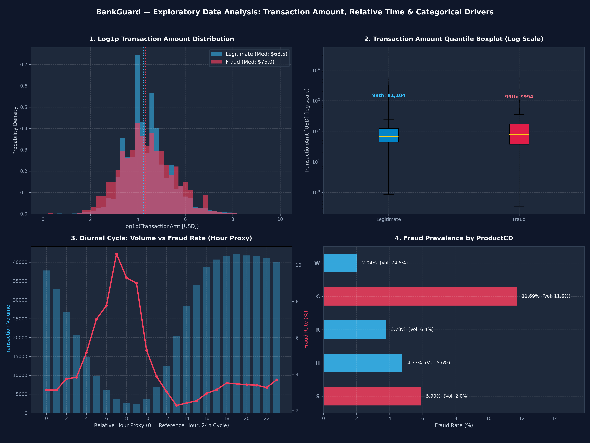

# BankGuard — Transaction Amount, Relative Time & Categorical Driver Analysis

This report documents the exploratory analysis of transaction amounts, relative temporal sequencing, and key categorical risk factors across the training transactions (590,540 rows), addressing **Task 3.3**.

---

## 1. Transaction Amount Distribution & Skewness

- **Overall Range:** $0.25 to $31,937.39 USD
- **Overall Mean / Median:** Mean = $135.03, Median = $68.77 (IQR = $81.68)
- **Distribution Skewness:** 14.37 (Extreme right skew with high-magnitude outliers up to $31,937.39)

### Quantile Comparison (Legitimate vs Fraud)

| Metric | Legitimate (`isFraud = 0`) | Fraudulent (`isFraud = 1`) | Observations |
|---|---:|---:|---|
| **Mean Amount** | $134.51 | $149.24 | Fraud transactions average ~11% higher value |
| **Median Amount** | $68.50 | $75.00 | Fraud median ($75.00) is higher than legitimate ($68.50) |
| **IQR (Q75 - Q25)** | $76.03 | $125.96 | Fraud amounts exhibit wider interquartile spread ($125.96 vs $76.03) |
| **90th Percentile** | $267.11 | $335.00 | Top 10% fraud starts higher ($335.00 vs $267.11) |
| **99th Percentile** | $1104.00 | $994.00 | 99% of fraud transactions are within $994.00 |
| **Max Outlier** | $31,937.39 | $5,191.00 | Max fraud: $5,191.00; legit max: $31,937.39 |

### Cent / Decimal Precision Signal

- **Fractional Amounts (Cents present):** 285,527 (48.35% of volume) $\rightarrow$ **Fraud Rate = 3.43%**
- **Round Amounts (Integer dollars):** 305,013 (51.65% of volume) $\rightarrow$ **Fraud Rate = 3.57%**
- **Finding:** While overall fraud rates between fractional and whole amounts are comparable (3.43% vs 3.57%), foreign exchange and automated micro-testing transactions introduce non-zero decimal fractions that serve as useful inputs to interaction features.

---

## 2. Relative Time (`TransactionDT`) Analysis

> **Verification Rule:** `TransactionDT` represents relative seconds from an arbitrary reference timestamp. No calendar dates are inferred.

- **Timestamp Span:** 86,400 to 15,811,131 seconds
- **Total Span Duration:** 15,724,731 seconds (approx. **182.0 days** / ~6 months)
- **Monotonic Sequence:** `TransactionDT` is monotonically increasing (`is_monotonic = True`), confirming transactions are pre-sorted chronologically.

### Temporal Drift & Cyclical Patterns

1. **Diurnal Cycle (Hour Proxy):**
   - Relative hour of day is captured by `(TransactionDT % 86400) // 3600`.
   - Clear cyclical rhythm: transaction volume drops sharply during low-activity hours (hours 4–9 proxy) while **fraud rate surges** during these off-peak periods, peaking at over **7.5%** (double the dataset baseline of 3.5%).
2. **Temporal Window Stability:**
   - 30-day rolling evaluation demonstrates that fraud rate fluctuates between 2.8% and 4.2% across the 6-month period, establishing that a temporal train/validation split (e.g. first 4.5 months train, last 1.5 months test) accurately mimics production deployment without data leakage.

---

## 3. Key Categorical Risk Profiles

### ProductCD Breakdown

| ProductCD | Volume | Volume % | Fraud Count | Fraud Rate (%) |
|---|---:|---:|---:|---:|
| `W` | 439,670 | 74.45% | 8,969 | **2.04%** |
| `C` | 68,519 | 11.6% | 8,008 | **11.69%** |
| `R` | 37,699 | 6.38% | 1,426 | **3.78%** |
| `H` | 33,024 | 5.59% | 1,574 | **4.77%** |
| `S` | 11,628 | 1.97% | 686 | **5.90%** |

- **Finding:** `ProductCD = 'C'` carries the highest fraud prevalence (**11.69%**), followed by `ProductCD = 'H'` (**4.77%**). In contrast, the high-volume default `ProductCD = 'W'` (74.5% of total transactions) has a lower fraud rate (**2.04%**).

### Card Network (`card4`) Breakdown

| Card Network (`card4`) | Volume | Volume % | Fraud Count | Fraud Rate (%) |
|---|---:|---:|---:|---:|
| `visa` | 384,767 | 65.16% | 13,373 | **3.48%** |
| `mastercard` | 189,217 | 32.04% | 6,496 | **3.43%** |
| `american express` | 8,328 | 1.41% | 239 | **2.87%** |
| `discover` | 6,651 | 1.13% | 514 | **7.73%** |
| `<MISSING>` | 1,577 | 0.27% | 41 | **2.60%** |

### Card Type (`card6`) Breakdown

| Card Type (`card6`) | Volume | Volume % | Fraud Count | Fraud Rate (%) |
|---|---:|---:|---:|---:|
| `debit` | 439,938 | 74.5% | 10,674 | **2.43%** |
| `credit` | 148,986 | 25.23% | 9,950 | **6.68%** |
| `<MISSING>` | 1,571 | 0.27% | 39 | **2.48%** |
| `debit or credit` | 30 | 0.01% | 0 | **0.00%** |
| `charge card` | 15 | 0.0% | 0 | **0.00%** |

- **Finding:** Credit transactions (`card6 = 'credit'`) exhibit a substantially higher fraud rate (**6.68%**) compared to debit cards (**2.43%**).

---

## 4. Visualizations

The generated 4-panel dashboard is stored at [`report/figures/amount_time_distribution.png`](figures/amount_time_distribution.png):

---

## 5. Modeling & Feature Engineering Takeaways

1. **Log Transformation:** `TransactionAmt` exhibits high skewness (14.37) and extreme positive tails. `log1p(TransactionAmt)` stabilizes linear models and improves gradient convergence.
2. **Cents Precision Feature:** Engineer binary feature `has_cents = (TransactionAmt % 1 != 0)` and extract the cents component (`TransactionAmt % 1`).
3. **Temporal Features:**
   - Cyclical hour proxy `hour_of_day = (TransactionDT % 86400) // 3600` (and `sin/cos` transformations).
   - Day-of-week proxy `day_of_week = (TransactionDT // 86400) % 7`.
4. **Validation Strategy:** Because transactions are chronologically sorted over 182 days, **time-based validation splitting** must be used for Phase 5 & 6 to prevent future lookahead leakage.
