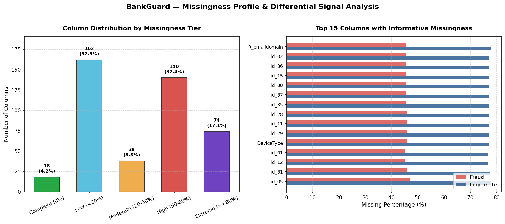

# BankGuard — Dataset Missingness & Signal Analysis

- **Total Features Analyzed:** 432
- **Total Rows:** 590,540
- **Complete Features (0% null):** 18 (4.2%)
- **Full Missingness Ranking:** [`report/missingness_ranking.csv`](missingness_ranking.csv)

## 1. Missingness Tier Breakdown

| Missingness Tier | Column Count | Percentage of Feature Space | Preprocessing Recommendation |
|---|---:|---:|---|
| `Complete (0%)` | 18 | 4.2% | Ready for baseline / tree models without imputation. |
| `Low (<20%)` | 162 | 37.5% | Simple median/most-frequent imputation or native tree handling. |
| `Moderate (20-50%)` | 38 | 8.8% | Tree native routing; add missingness indicator flag for linear baseline. |
| `High (50-80%)` | 140 | 32.4% | Identity features & distance; retain if informative, test exclusion in baseline. |
| `Extreme (>=80%)` | 74 | 17.1% | Rare identity codes & device fields; filter out uninformative near-empty features. |

## 2. Visual Representation

## 3. Top Informative Missingness Features

Columns where missingness rate strongly differs between fraudulent and legitimate transactions, serving as a direct predictive signal:

| Column Name | Overall Null % | Fraud Null % | Legit Null % | Discrepancy (Fraud - Legit) | Tier |
|---|---:|---:|---:|---:|:---:|
| `R_emaildomain` | 76.75% | 45.67% | 77.88% | **-32.21%** | `High (50-80%)` |
| `id_02` | 76.15% | 45.69% | 77.25% | **-31.56%** | `High (50-80%)` |
| `id_36` | 76.13% | 45.69% | 77.23% | **-31.54%** | `High (50-80%)` |
| `id_15` | 76.13% | 45.69% | 77.23% | **-31.54%** | `High (50-80%)` |
| `id_38` | 76.13% | 45.69% | 77.23% | **-31.54%** | `High (50-80%)` |
| `id_37` | 76.13% | 45.69% | 77.23% | **-31.54%** | `High (50-80%)` |
| `id_35` | 76.13% | 45.69% | 77.23% | **-31.54%** | `High (50-80%)` |
| `id_28` | 76.13% | 45.71% | 77.23% | **-31.52%** | `High (50-80%)` |
| `id_11` | 76.13% | 45.71% | 77.23% | **-31.52%** | `High (50-80%)` |
| `id_29` | 76.13% | 45.71% | 77.23% | **-31.52%** | `High (50-80%)` |
| `DeviceType` | 76.16% | 45.74% | 77.26% | **-31.51%** | `High (50-80%)` |
| `id_01` | 75.58% | 45.23% | 76.68% | **-31.45%** | `High (50-80%)` |
| `id_12` | 75.58% | 45.23% | 76.68% | **-31.45%** | `High (50-80%)` |
| `id_31` | 76.25% | 45.94% | 77.34% | **-31.41%** | `High (50-80%)` |
| `id_05` | 76.82% | 46.85% | 77.91% | **-31.06%** | `High (50-80%)` |

## 4. Key Findings and Modeling Decisions

1. **Missingness is Informative (Not Noise):** Several key attributes (e.g. `dist2`, identity device attributes, and `R_emaildomain`) display substantial differences in missingness between fraud and non-fraud transactions. Missing values must not be blindly imputed or discarded.
2. **Tree-Based Advantage:** Modern gradient boosted trees (LightGBM, XGBoost) natively learn optimal branching directions for `NaN` values, naturally leveraging informative missingness without data distortion.
3. **Linear Baseline Requirement:** For linear models (Logistic Regression), adding a `_isna` binary indicator feature alongside median/mode imputation preserves the missingness signal without data loss.
