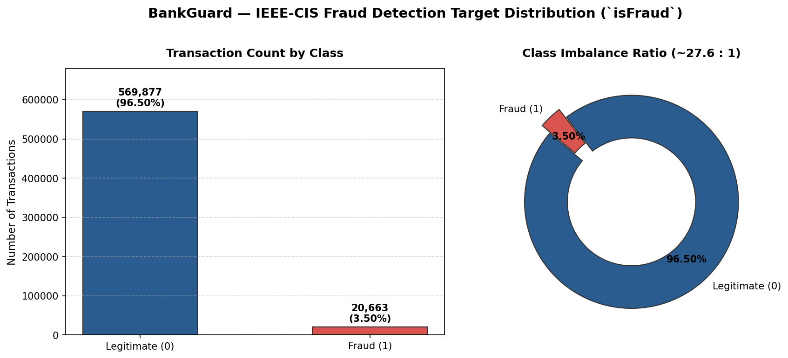

# BankGuard — Target Distribution Analysis (`isFraud`)

## 1. Class Distribution Summary

| Metric | Value |
|---|---:|
| Total Training Transactions | **590,540** |
| Legitimate Transactions (`isFraud = 0`) | **569,877** |
| Fraudulent Transactions (`isFraud = 1`) | **20,663** |
| Legitimate Percentage | **96.5010%** |
| Fraud Percentage | **3.4990%** |
| Imbalance Ratio | **27.58 : 1** (legitimate per fraud) |
| Invariant Sum Check (`0 + 1 == total`) | **PASSED** |

## 2. Visual Representation

## 3. Modeling and Evaluation Implications

1. **Accuracy is Misleading:** A naive model predicting `0` (legitimate) for all rows achieves **96.50% accuracy** while detecting exactly **0% of fraud**. Accuracy must never be used as the primary optimization or selection metric.
2. **Primary Evaluation Metrics:** Models must be compared using **PR-AUC (Average Precision)**, **Recall@Precision**, **ROC-AUC**, and the full confusion matrix.
3. **Split Strategy:** All cross-validation and train/validation splits must use **stratified sampling** (`StratifiedKFold` / `stratify=y`) to maintain the exact ~3.5% fraud prevalence across partitions.
4. **Decision Thresholds:** Default threshold 0.5 is almost certainly suboptimal for operational deployment; calibrated thresholds balancing review queue capacity against missed fraud costs are required (Phase 6).
